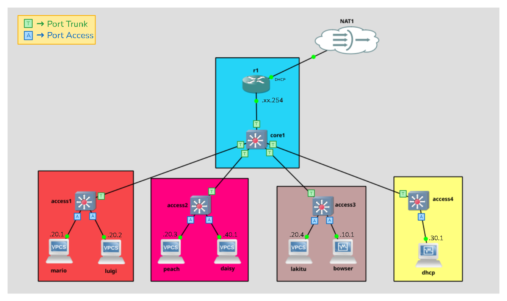

# Infrastructure réseau sécurisée : attaques L2 et contre-mesures


Projet réalisé à l'EFREI (Bachelor Cybersécurité & Ethical Hacking) : construction d'un réseau d'entreprise segmenté en VLAN sous GNS3, attaque de cette infrastructure (DHCP, ARP), puis durcissement des switchs pour bloquer ces attaques. Chaque étape est prouvée par les configurations Cisco et les captures Wireshark.

---

## Topologie



| VLAN | Rôle | Réseau | Passerelle |
|------|------|--------|------------|
| 10 | Admins | `10.1.10.0/24` | `10.1.10.254` |
| 20 | Clients | `10.1.20.0/24` | `10.1.20.254` |
| 30 | Serveurs | `10.1.30.0/24` | `10.1.30.254` |
| 40 | Invités | `10.1.40.0/24` | `10.1.40.254` |

- **r1** : routage inter-VLAN en *router-on-a-stick* (sous-interfaces 802.1Q), NAT/PAT vers Internet, relais DHCP (`ip helper-address`)
- **core1** + **access1 → access4** : switchs de cœur et d'accès, liens trunk 802.1Q
- **dhcp** (`10.1.30.1`) : serveur DHCP `dnsmasq` centralisé, une plage par VLAN

---

## TP1 : Mise en place de l'infrastructure

Dossier : [`tp1/`](tp1)

- Configuration des VLAN, trunks et ports d'accès sur les 4 switchs
- Routage inter-VLAN et NAT sur r1
- Serveur DHCP centralisé ([`dnsmasq.conf`](tp1/dnsmasq.conf)) relayé vers chaque VLAN

| Capture | Ce qu'elle montre |
|---------|-------------------|
| `p1_routed_ping.pcapng` | Ping inter-VLAN (VLAN 20 → VLAN 40) via r1 |
| `p2_no_nat.pcapng` / `p2_nat.pcapng` | Sortie Internet sans puis avec NAT |
| `p2_routed_ping.pcapng` | Client du VLAN 20 qui joint un hôte sur Internet |
| `p3_dhcp.pcapng` | Échange DHCP complet (Discover → Offer → Request → Ack) via le relais |

---

## TP2 : Attaques

Dossier : [`tp2/`](tp2)

Attaques menées depuis une machine du VLAN 10 avec **Scapy**.

| Attaque | Capture | Résultat observé |
|---------|---------|------------------|
| **DHCP starvation** | `p1_dhcp_starvation.pcapng` | 100 requêtes avec des MAC aléatoires ([`dhcp_stravation.py`](tp2/dhcp_stravation.py)) : la plage du VLAN est épuisée |
| **Rogue DHCP (race)** | `p1_dhcp_race.pcapng` | Un faux serveur DHCP (`10.1.10.50`) répond avant le légitime et attribue la configuration à la victime |
| **Déni de service DHCP** | `p1_dhcp_dos.pcapng` | Conséquence de la starvation : un client légitime envoie des DHCP Discover qui restent sans réponse |
| **ARP poisoning** | `p2_poisoning.pcapng` | L'attaquant annonce sa MAC comme celle de la passerelle `10.1.10.254` |
| **Man-in-the-Middle** | `p2_mitm.pcapng` | Empoisonnement dans les deux sens (victime ↔ passerelle) : le trafic ICMP de la victime passe par l'attaquant |

---

## TP3 : Durcissement des switchs

Dossier : [`tp3/`](tp3)

Contre-mesures appliquées sur les 4 switchs d'accès :

| Protection | Configuration | Bloque |
|------------|---------------|--------|
| **DHCP Snooping** | Activé sur les VLAN 10-40, seul l'uplink est *trusted*, limite à 10 paquets DHCP/s par port | Rogue DHCP, starvation |
| **Dynamic ARP Inspection** | Activé sur les VLAN 10-40, vérification par rapport à la table de snooping, limite à 60 paquets ARP/s | ARP poisoning, MITM |
| **IP Source Guard** | `ip verify source` sur les ports d'accès | Usurpation d'adresse IP |

```
ip dhcp snooping
ip dhcp snooping vlan 10,20,30,40
ip arp inspection vlan 10,20,30,40
!
interface Ethernet0/0
 description TRUNK_VERS_CORE
 ip dhcp snooping trust
 ip arp inspection trust
!
interface Ethernet0/1
 switchport access vlan 20
 ip verify source
 ip dhcp snooping limit rate 10
 ip arp inspection limit rate 60
```

---

## Compétences mobilisées

`VLAN / 802.1Q` · `Routage inter-VLAN` · `NAT/PAT` · `DHCP & relais` · `Scapy` · `Analyse de trames Wireshark` · `Sécurité de niveau 2` · `Cisco IOS`

> ⚠️ Les attaques ont été réalisées uniquement dans un lab isolé, à des fins pédagogiques.
